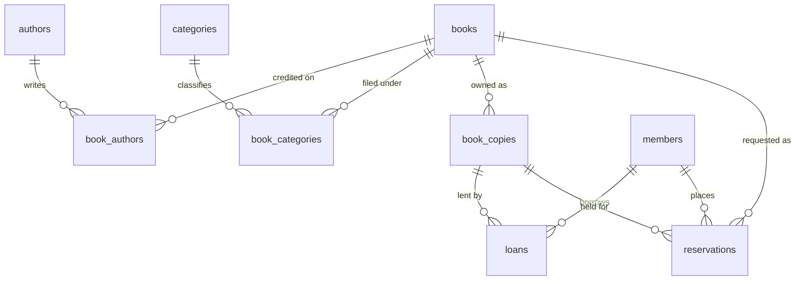

# Conceptual, logical, and physical models

The same library is described three times. The conceptual model names the things and the relationships. The logical model names tables, keys, and constraints. The physical model names types, indexes, and the functions that keep two tables consistent.

## Conceptual model

A **work** has a title and an ISBN. One or more **authors** write it, in a byline order. Zero or more **categories** classify it. The library may own zero or more **copies** of the work. Each copy has a barcode and a condition, and it is available, on loan, held, in maintenance, or lost.

A **member** has a card number, an email, a membership status, and a limit on how many copies they may have out. A **loan** connects one member to one copy for an interval that starts at checkout and ends at return. While the loan is open, that copy is not available to anyone else.

A **reservation** connects one member to one work. It is waiting, ready, fulfilled, cancelled, or expired. When it is ready, one copy of that work is held for the member.

Cardinalities worth stating in words:

- Author to book is many-to-many. The relationship has an attribute, `author_order`.
- Category to book is many-to-many. The relationship has no attributes of its own, so the junction table is only the two keys.
- Book to copy is one-to-many. A copy belongs to exactly one title. Forthcoming Catalog has zero copies, which the optional side allows.
- Copy to loan is one-to-many across time, and at most one-to-one among open loans.
- Member to loan is one-to-many. Farah Mensah has zero loans.
- Reservation to book is many-to-one. The member asks for the work. The optional `ready_copy_id` points at a copy only while the reservation is ready.

## Logical model

| Relation | Primary key | Other candidate or unique keys |
| --- | --- | --- |
| `authors` | `author_id` | none on the name |
| `books` | `book_id` | `isbn13` |
| `book_authors` | `(book_id, author_id)` | `(book_id, author_order)` |
| `categories` | `category_id` | `name` |
| `book_categories` | `(book_id, category_id)` | the primary key is the whole row |
| `members` | `member_id` | `member_number`, `email` |
| `book_copies` | `copy_id` | `barcode` |
| `loans` | `loan_id` | `copy_id` where `returned_at` is null |
| `reservations` | `reservation_id` | `(member_id, book_id)` where status is waiting or ready |

Why surrogate primary keys sit next to unique natural keys: an ISBN can be corrected, and a barcode can be replaced, without rewriting every foreign key. The natural key is still enforced, so the catalog cannot contain two rows for one ISBN. `book_authors` and `book_categories` do not get their own surrogates. A byline row has no identity apart from the author and the book.

`copy_status` is an attribute of the copy, and it is also constrained by the open loans. That is a multi-table rule, not a second copy of the member's name stuffed into the loan. Normalization is discussed in [normalization.md](normalization.md). The short version: `on_loan` means exactly one open loan, and every other status means zero. `available`, `held`, `maintenance`, and `lost` are different facts that all share "no open loan," so status is not a function of the loan table alone.

Attributes that look derived and are stored anyway:

- `copy_status` is stored so the desk can read one row under a row lock. The deferred trigger rejects a commit that disagrees with `loans`.
- `days_overdue` is not stored. The view computes it.
- Borrow rank is not stored. The window query computes it.

## Physical model

PostgreSQL 16 stores each table as a heap. The default page size is 8 kB. A row that does not fit in a page can be toasted. None of these rows are wide enough for that to matter at laboratory scale. Identity columns use sequences (`books_book_id_seq` and its siblings). The seed inserts explicit ids with `OVERRIDING SYSTEM VALUE` and then calls `setval` so the next checkout receives a new `loan_id`.

Types:

- `bigint` identity for surrogate keys. The values fit in a Python `int` through `psycopg`.
- `text` for names, titles, emails, barcodes, and status codes. Status codes are also restricted by `CHECK`.
- `integer` for years, page counts, and loan limits. `smallint` for byline position.
- `date` for joined-on and acquired-on. These are calendar dates with no time zone.
- `timestamptz` for checkout, due, return, and reservation instants. The seed writes every instant with an explicit `+00` offset, so the session `TimeZone` does not move the rows.

Indexes that exist because of a key:

- A primary key and a unique constraint each create a unique B-tree.
- `loans_one_open_copy_idx` and `reservations_one_active_member_book_idx` are partial unique B-trees. PostgreSQL expresses "unique among the rows that match this predicate" as an index. They are integrity rules first. Migration `002_indexes.sql` does not create them, and `make explain` does not drop them when it shows a "before" plan.

Indexes that exist for access paths are in migration 002. PostgreSQL does not automatically index the referencing column of a foreign key. `book_authors`'s primary key `(book_id, author_id)` supports a lookup by book. A lookup by author, and the check that runs when an author is deleted, needs `book_authors_author_id_idx`. The same pattern is why `loans_copy_id_idx` exists even though open loans are already indexed: returned loans are outside that partial index, and deleting a copy must find them.

Functions and views live in migration 003. `checkout_copy` and `return_copy` are `LANGUAGE plpgsql` with `search_path` fixed to `pg_catalog, public`, so a local object cannot shadow `now` or `count`. The reporting views are stored queries. `overdue_loans` uses `now()`, which is stable for the duration of one transaction and different on the next. `days_overdue` divides the epoch interval by 86400. `EXTRACT(DAY FROM interval)` is only the days field after PostgreSQL justifies an interval into months, so it is the wrong total.

`schema_migrations` is created by the Python runner, not by a migration file. It stores the filename and the time it was applied. The reset strategy in the README is the way to rebuild. There is no down migration.

## From the seed, one object of each kind

Mira Chen (`author_id` 1) and Jonah Adeyemi (`author_id` 2) write *Foundations of Relational Design* (`book_id` 1, ISBN `9780004611006`), Mira first. The title is in Databases and Computer Science. Three copies exist. `CPY-000102` is on loan to Avery Nguyen as loan 4, due 2020-05-22, still open. Avery also has an open loan for *Poetry of the North Shore* and two returned loans. Blake Okonkwo's limit is 2 and both slots are full. Cartography is a category with no titles. *Unclassified Field Notes* is a title with no category. *Forthcoming Catalog* is a title with no copies. Devon's reservation for the poetry title is `ready` and holds `CPY-000802`.
